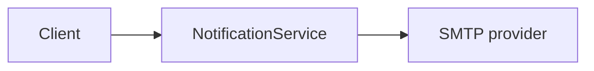
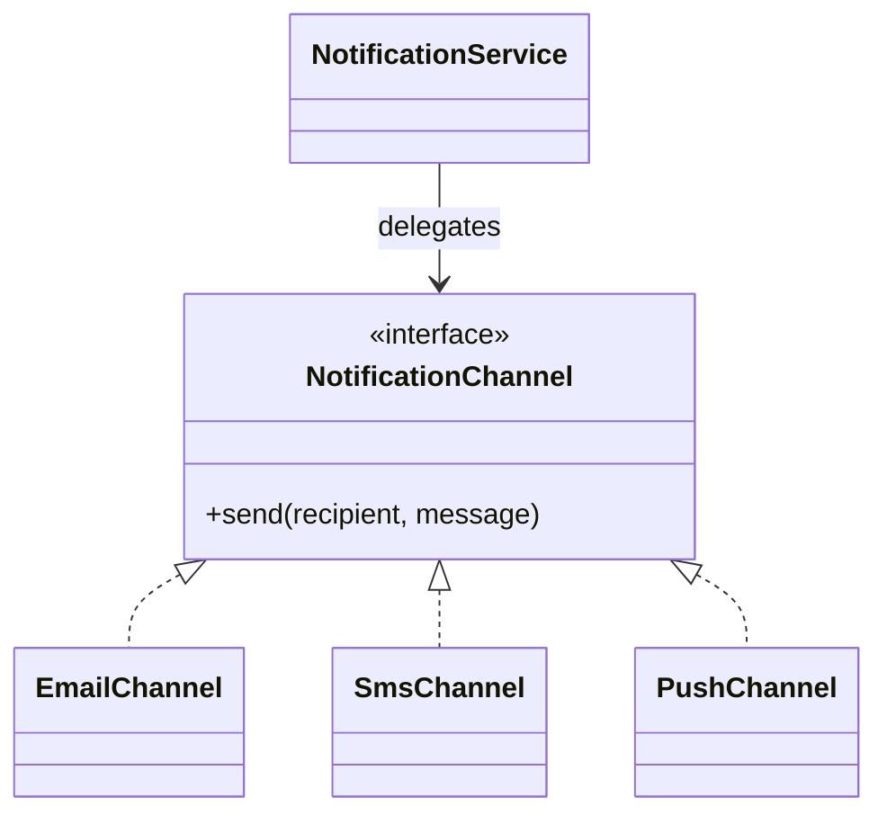
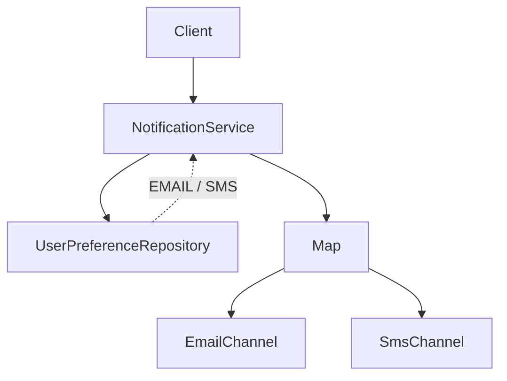
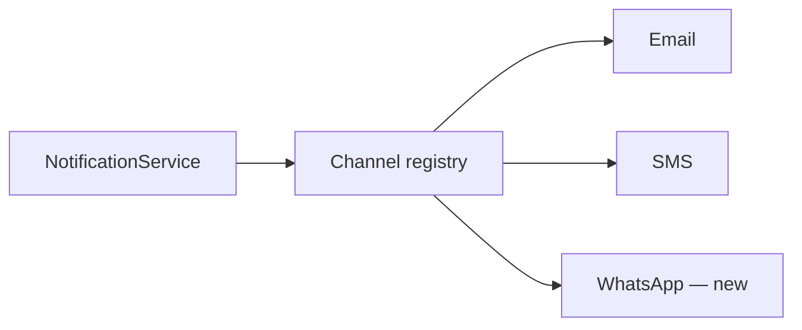
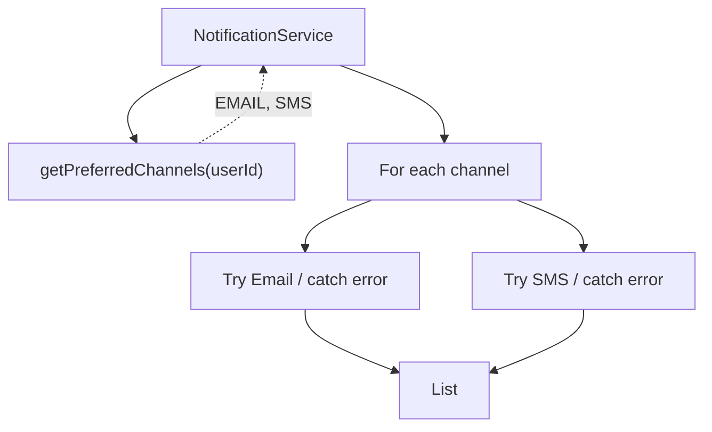
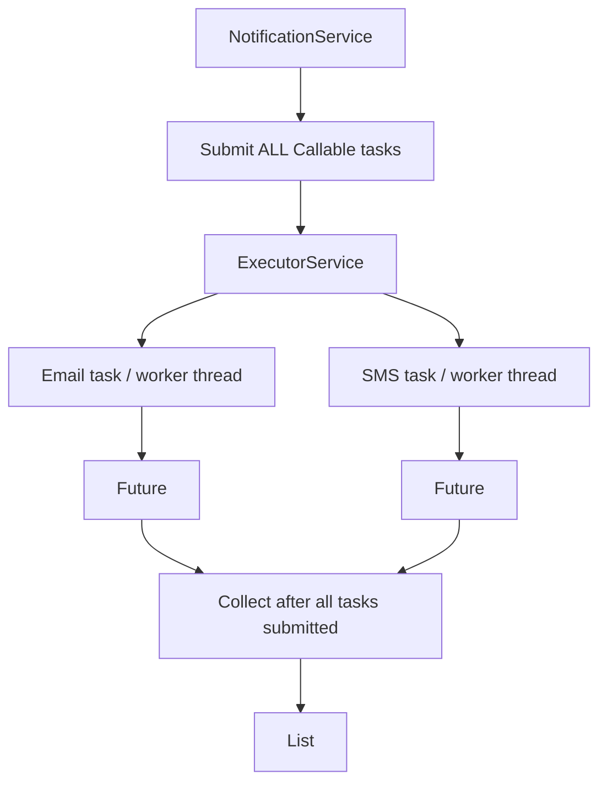
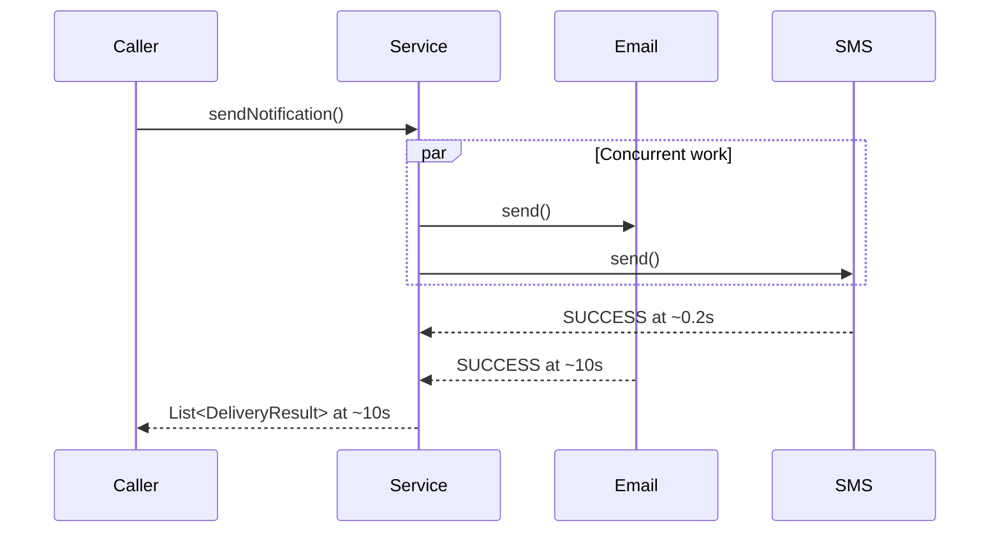
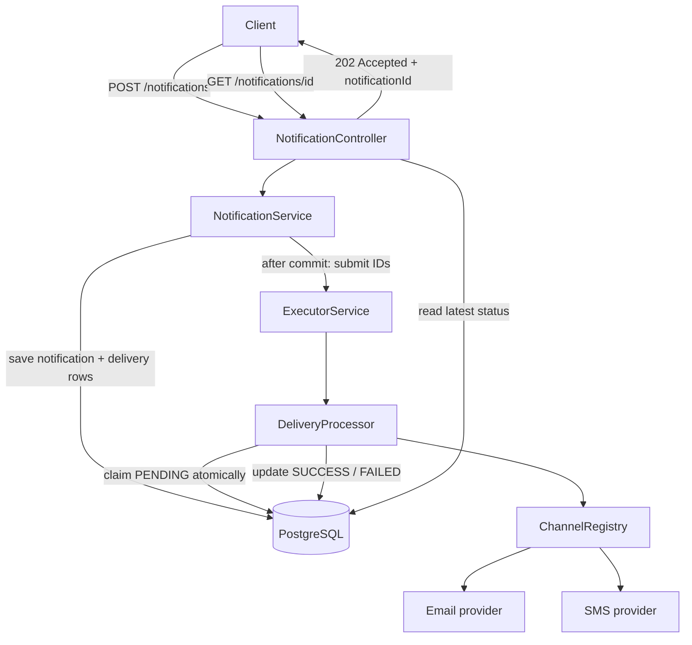
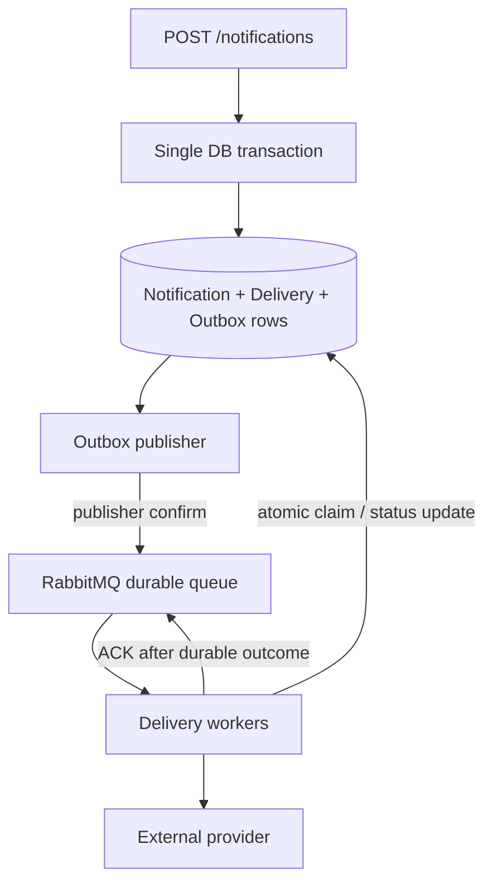
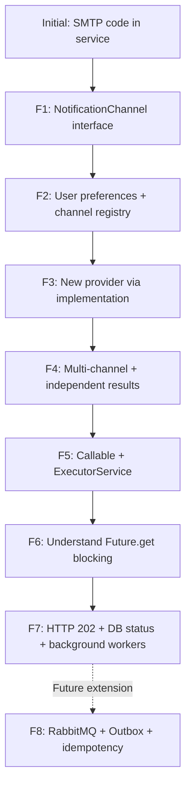

# Notification Service — Step-by-Step Design Evolution

> **How to use this guide:** Each follow-up shows the *new requirement*, a diagram of the design **at that moment**, the relevant Java code, and the reasoning. Snippets are intentionally incremental teaching examples. The complete runnable implementations are in [V1](../v1-concurrent-core) and [V2](../v2-async-api).
>
> **Legend:** Solid arrows are calls/dependencies. Dashed arrows are results/status updates. Mermaid diagrams render directly on GitHub.

## Starting point — Email only

**Requirement:** Send an email.



```java
class NotificationService {
    void sendNotification(String email, String message) {
        // SMTP-specific code lives here.
    }
}
```

**Problem:** This class owns both orchestration and provider-specific delivery. Every new channel requires changing it.

---

## Follow-up 1 — Add SMS and Push (abstraction boundary)

**New requirement:** Support Email, SMS, and eventually Push without rewriting the core service.



```java
interface NotificationChannel {
    void send(String recipient, String message) throws Exception;
}
class EmailChannel implements NotificationChannel {
    public void send(String recipient, String message) {
        // Call email provider
    }
}
class SmsChannel implements NotificationChannel {
    public void send(String recipient, String message) {
        // Call SMS provider
    }
}
class NotificationService {
    private final NotificationChannel channel;
    NotificationService(NotificationChannel channel) { this.channel = channel; }
    void sendNotification(String recipient, String message) throws Exception {
        channel.send(recipient, message);
    }
}
```

**Why:** The interface describes the capability the service needs (*send*), not a provider-specific operation such as `sendEmail()`. Adding a provider means implementing the contract.

**Interview takeaway:** “I would isolate provider-specific behavior behind a `NotificationChannel` interface and inject an implementation.”

---

## Follow-up 2 — Different users prefer different channels (runtime selection)

**New requirement:** One service instance must serve many users, each with their own preferred channel.



```java
enum ChannelType { EMAIL, SMS, PUSH }
interface UserPreferenceRepository {
    ChannelType getPreferredChannel(String userId);
}
class NotificationService {
    private final UserPreferenceRepository preferences;
    private final Map<ChannelType, NotificationChannel> channels;
    void sendNotification(String userId, String recipient, String message)
            throws Exception {
        ChannelType type = preferences.getPreferredChannel(userId);
        NotificationChannel channel = channels.get(type);
        if (channel == null) throw new IllegalArgumentException("Unsupported " + type);
        channel.send(recipient, message);
    }
}
```

**What changed:** A single injected implementation became a **registry**. Preference lookup is separate from sending.

**Interview takeaway:** “The interface handles implementation variation; the registry handles runtime selection.”

---

## Follow-up 3 — Add WhatsApp (Open/Closed Principle)

**New requirement:** Introduce another channel without rewriting delivery orchestration.



```java
class WhatsAppChannel implements NotificationChannel {
    @Override
    public void send(String recipient, String message) {
        // Call WhatsApp provider
    }
}
// At application composition / configuration:
channels.put(ChannelType.WHATSAPP, new WhatsAppChannel());
```

`ChannelType` must also include `WHATSAPP` if using an enum.

**What stayed the same:** The `NotificationService` send flow and `NotificationChannel.send()` contract.

**Interview takeaway:** “Extend the implementation set and configuration; avoid adding a giant `switch` inside the service.”

---

## Follow-up 4 — Multiple channels, independent failures, per-channel results

**New requirement:** A user can select Email **and** SMS. Email failure must not prevent SMS. Return individual outcomes.



```java
record DeliveryResult(ChannelType channel, boolean success, String error) {}
interface UserPreferenceRepository {
    List<ChannelType> getPreferredChannels(String userId);
}
List<DeliveryResult> sendNotification(String userId, String recipient, String message) {
    List<DeliveryResult> results = new ArrayList<>();
    for (ChannelType type : preferences.getPreferredChannels(userId)) {
        try {
            channels.get(type).send(recipient, message);
            results.add(new DeliveryResult(type, true, null));
        } catch (Exception e) {
            results.add(new DeliveryResult(type, false, e.getMessage()));
        }
    }
    return results;
}
```

**Important:** This version still runs **sequentially**. The `try/catch` is **inside** the loop, so one provider failure does not abort other deliveries.

**Interview takeaway:** “A channel owns how to send. The service owns which channels to invoke and how to aggregate results.”

---

## Follow-up 5 — Slow Email must not delay SMS (concurrency)

**New requirement:** Email may take 10 seconds, SMS 200 milliseconds. Run them independently using `ExecutorService`.



```java
List<Future<DeliveryResult>> futures = new ArrayList<>();

// FIRST loop: submit all tasks, without waiting.
for (ChannelType type : preferences.getPreferredChannels(userId)) {
    Callable<DeliveryResult> task = () -> {
        try {
            channels.get(type).send(recipientFor(userId, type), message);
            return new DeliveryResult(type, true, null);
        } catch (Exception e) {
            return new DeliveryResult(type, false, e.getMessage());
        }
    };
    futures.add(executor.submit(task));
}

// SECOND loop: collect results.
List<DeliveryResult> results = new ArrayList<>();
for (Future<DeliveryResult> future : futures) {
    try {
        results.add(future.get());
    } catch (InterruptedException e) {
        Thread.currentThread().interrupt();
        throw new IllegalStateException("Interrupted", e);
    } catch (ExecutionException e) {
        throw new IllegalStateException("Unexpected task failure", e);
    }
}
return results;
```

**Why two loops?** If you submit Email and immediately call `get()`, you wait before even submitting SMS. Submitting everything first allows parallel execution.

**What timeout does:** It bounds a slow provider call. It does **not** itself create concurrency.

**Interview takeaway:** “One `Callable` per delivery; `NotificationService` coordinates tasks but does not itself implement `Callable`.”

---

## Follow-up 6 — Concurrency is not an asynchronous HTTP response

**Question:** Email takes 10s, SMS takes 0.2s, both start together. How long does a caller waiting for the combined result wait?



**Answer: ~10 seconds.** SMS **executes** independently, but the combined response still waits for Email because of `Future.get()`.

**Interview takeaway:** “Concurrency describes task execution. Async HTTP describes whether the request waits for completion.”

---

## Follow-up 7 — HTTP API returns immediately, client checks status later (V2)

**New requirement:** Return quickly, while deliveries continue in background. Clients need a status endpoint.



**API contract**

```http
POST /notifications
Content-Type: application/json

{"userId":"alice","message":"Hello"}
```

```http
HTTP/1.1 202 Accepted
Location: /notifications/abc-123

{"notificationId":"abc-123","status":"PENDING"}
```

```http
GET /notifications/abc-123
```

```json
{
  "notificationId": "abc-123",
  "userId": "alice",
  "deliveries": [
    {"deliveryId":"d1","channel":"EMAIL","status":"PROCESSING","attempts":1,"error":null},
    {"deliveryId":"d2","channel":"SMS","status":"SUCCESS","attempts":1,"error":null}
  ]
}
```

**Core code — request path (simplified)**

```java
@Transactional
public String submit(String userId, String message) {
    String notificationId = UUID.randomUUID().toString();
    // Persist notification and PENDING delivery rows in one transaction.
    // Register afterCommit callback to submit one task per delivery.
    // Do NOT call Future.get() here.
    return notificationId;
}
```

**Core code — worker**

```java
public void process(String deliveryId) {
    if (!state.claim(deliveryId)) return; // Atomic PENDING -> PROCESSING
    try {
        // Load delivery + notification, resolve recipient and channel.
        channel.send(recipient, message);
        state.finish(deliveryId, DeliveryStatus.SUCCESS, null);
    } catch (Exception e) {
        state.finish(deliveryId, DeliveryStatus.FAILED, "Delivery attempt failed");
    }
}
```

**Core code — conditional DB claim**

```sql
UPDATE deliveries
SET status = 'PROCESSING', attempts = attempts + 1
WHERE id = :deliveryId AND status = 'PENDING';
-- Only the worker that updates 1 row has claimed the task.
```

**Why:** The DB stores the state; `Future` objects are not durable status records. The API returns a job ID, not a delivery confirmation.

**Important limitations of V2:** The code uses an **in-memory** executor. If the app crashes after DB commit but before task submission, a PENDING row may be stranded. If a worker crashes mid-send, PROCESSING may remain stuck. A 100ms latency guarantee is not established.

**Interview takeaway:** “Return 202 with an ID, persist per-channel status, and let background workers update that status. The GET endpoint reads the DB.”

---

## Beyond V2 — Follow-up 8: RabbitMQ, ACK, Outbox (design only)

**New requirement:** Survive restarts and reliably process queued tasks.



**Failure case:** DB commit succeeds, app crashes before publishing. RabbitMQ has **no message to redeliver**. The transactional outbox allows a publisher to find and publish the committed event later.

**Duplicate case:** Email provider succeeds, worker crashes before ACK. RabbitMQ redelivers and a second send is possible. A DB claim prevents simultaneous claims, but **does not guarantee exactly-once external delivery** after ambiguous provider outcomes. Provider idempotency keys, when available, reduce duplicate effects.

**Interview takeaway:** “RabbitMQ provides durable asynchronous transport with suitable configuration; outbox bridges the DB-to-broker gap; idempotency handles at-least-once processing.”

> This is an architecture discussion only. **RabbitMQ, outbox, automated retries and recovery are not implemented in V1/V2.**

---

## Full evolution summary



**Interview habit to practice at every step:** Identify what changed → assign the new responsibility → preserve stable interfaces → explain the failure case → name the trade-off.
